# FlowTodo

建立日期：2026-11-24
最近更新：2026-11-25

## 结论

`FlowTodo` 是一个参考 Apple HIG 与 iOS 26 Liquid Glass、原创素材的本地待办 PWA，参考 TickTick 的任务管理信息架构，
但不包含 TickTick 的商标、图标、文案、代码或 IPA 内资源。

界面采用原创的 Apple iOS 26 Liquid Glass 语言：侧栏、顶栏、搜索框、弹窗和浮动 Tab Bar 共用一套液态玻璃材质，
主内容从悬浮顶栏与 Tab Bar 下方穿过。浅色玻璃为 `rgba(255,255,255,.48)`，深色为 `rgba(28,28,30,.52)`，
配合 `blur(30px) saturate(180%)`、顶部镜面高光、底部落座阴影和 `0.5px` 外圈发丝线。
强调色只保留系统蓝（浅色 `#007AFF`、深色 `#0A84FF`），不再使用紫蓝渐变、彩色玻璃 tint 或厚卡片堆叠。
桌面端为悬浮侧栏和内容区，手机端为左右/底部各内缩 12px 的浮动胶囊 Tab Bar。
应用主体仍可双击直接打开，PWA 外壳提供安装入口与离线缓存。
当前版本功能完整，包含周课表、CSV 导入 / ICS 导出和今天页课程摘要；只是没有预置业务数据。
首次打开是空白待办页，课表保留 `2026-09-07` 开学、18 周、每天 10 节、周一至周五的设置，课程列表为空，
需要自行导入 CSV 或新建课程。

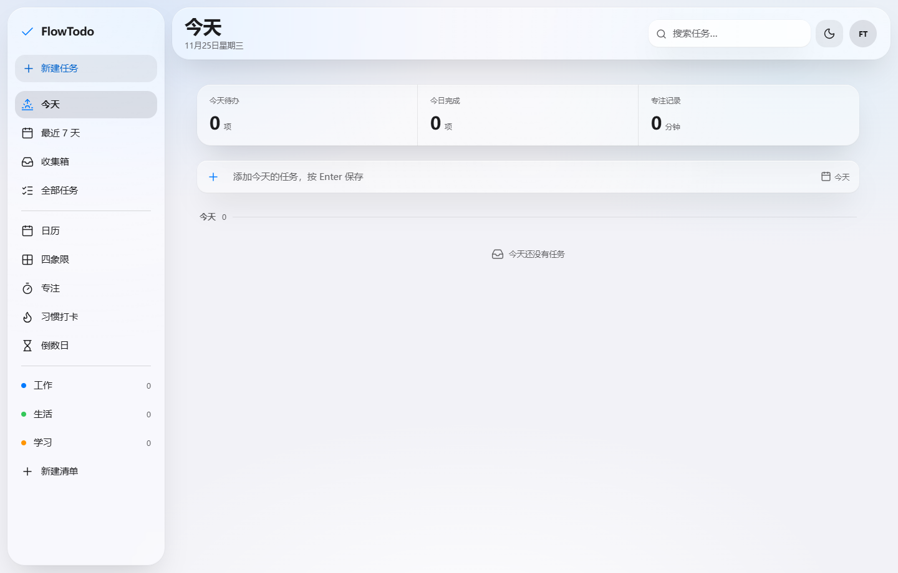

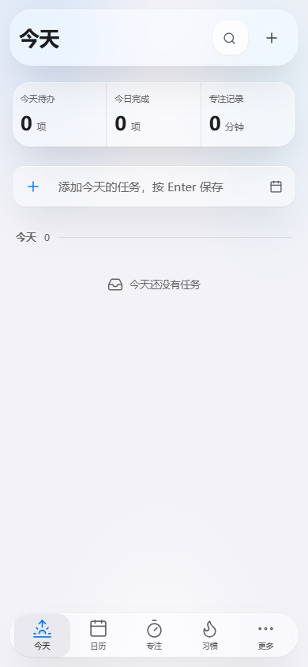

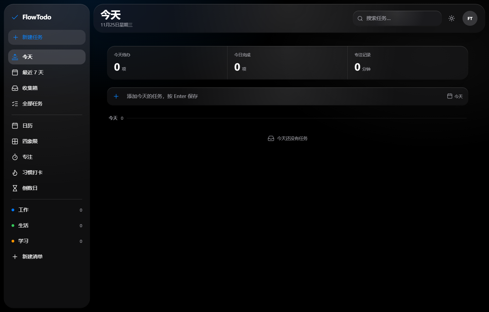

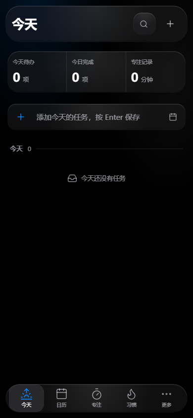

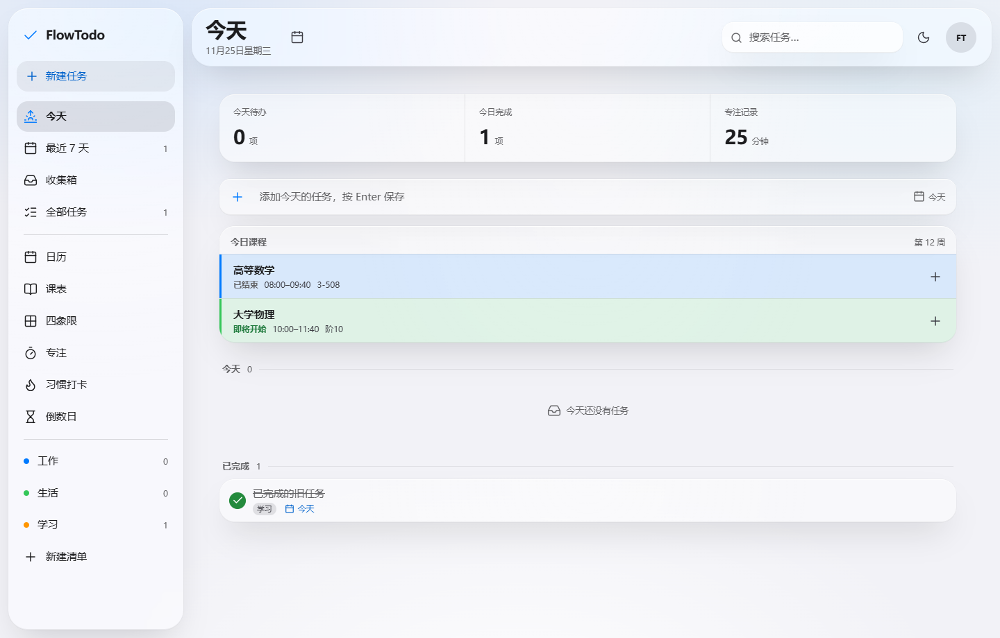

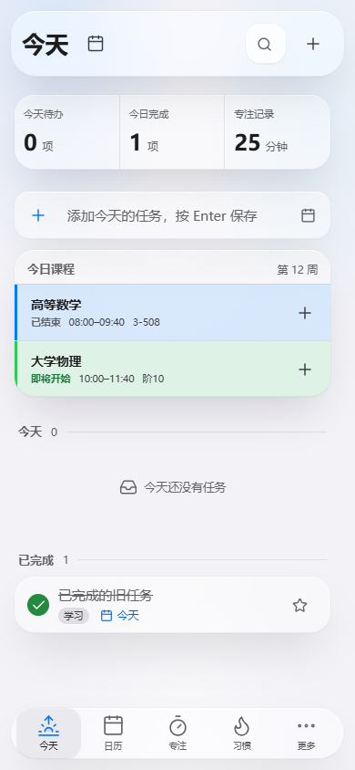

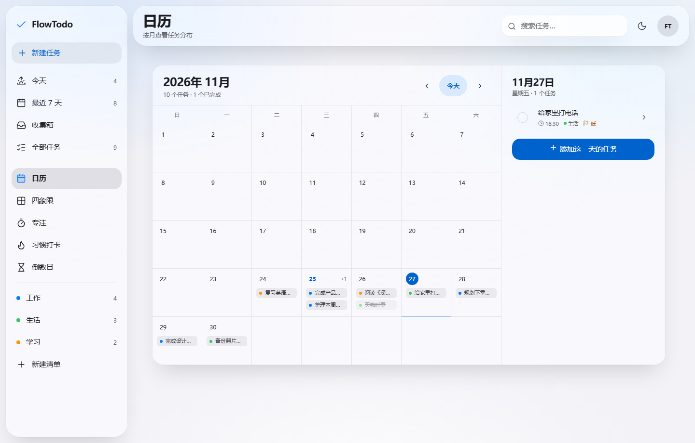

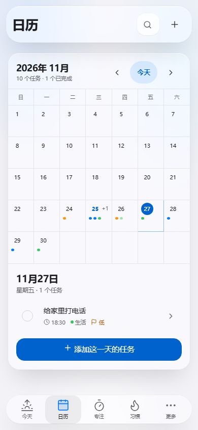

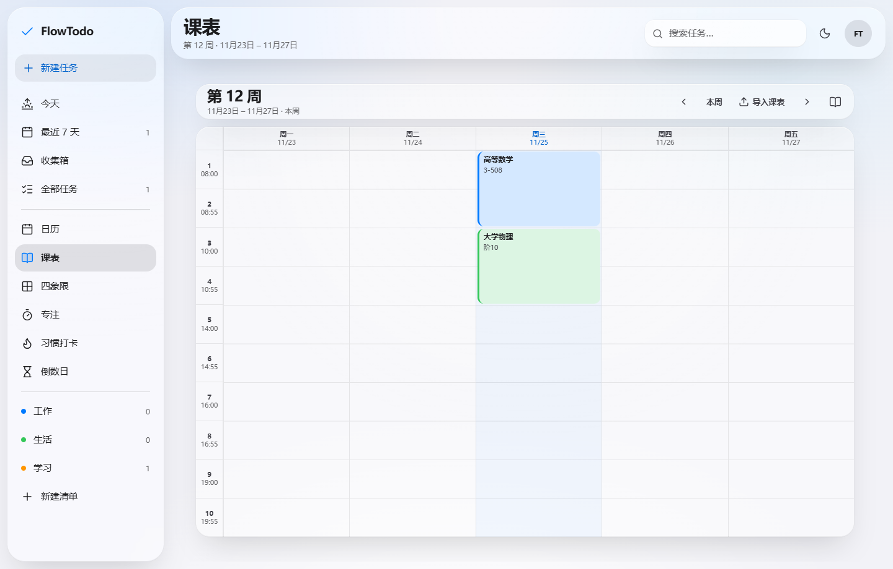

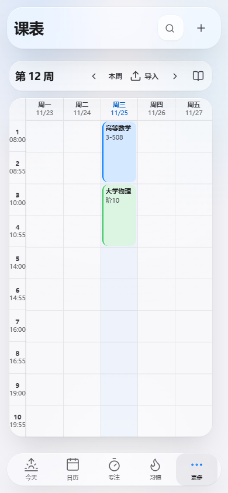

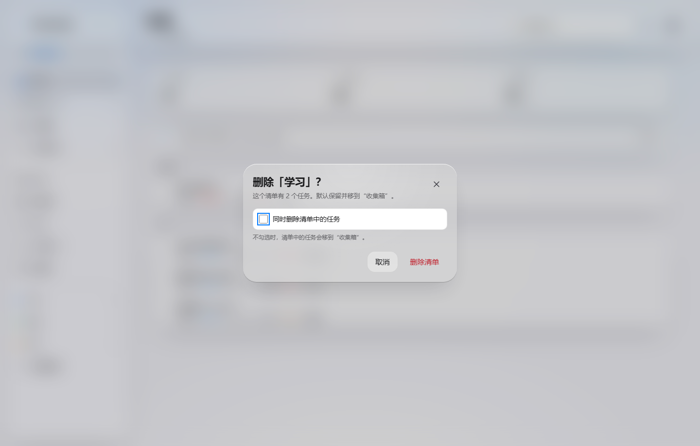

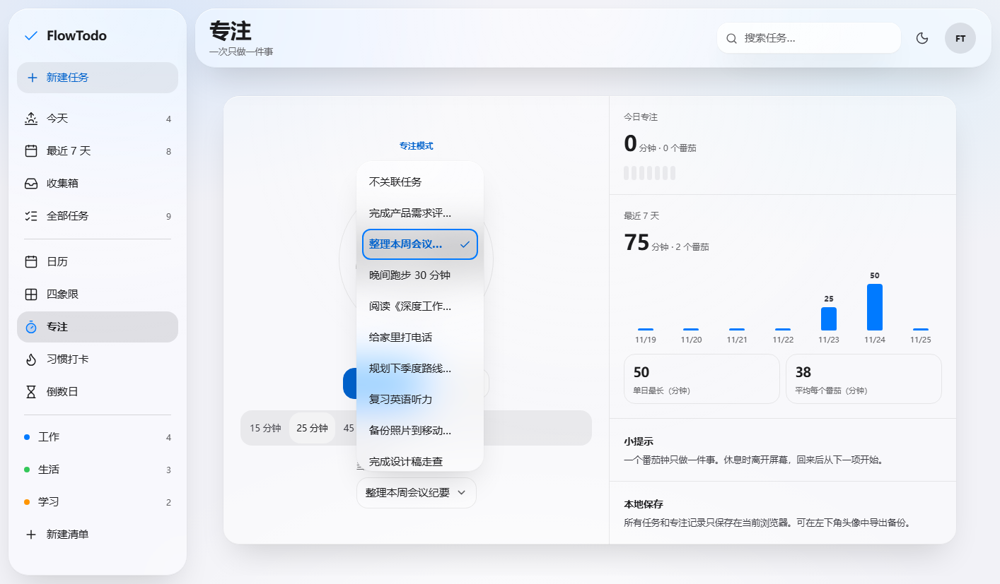

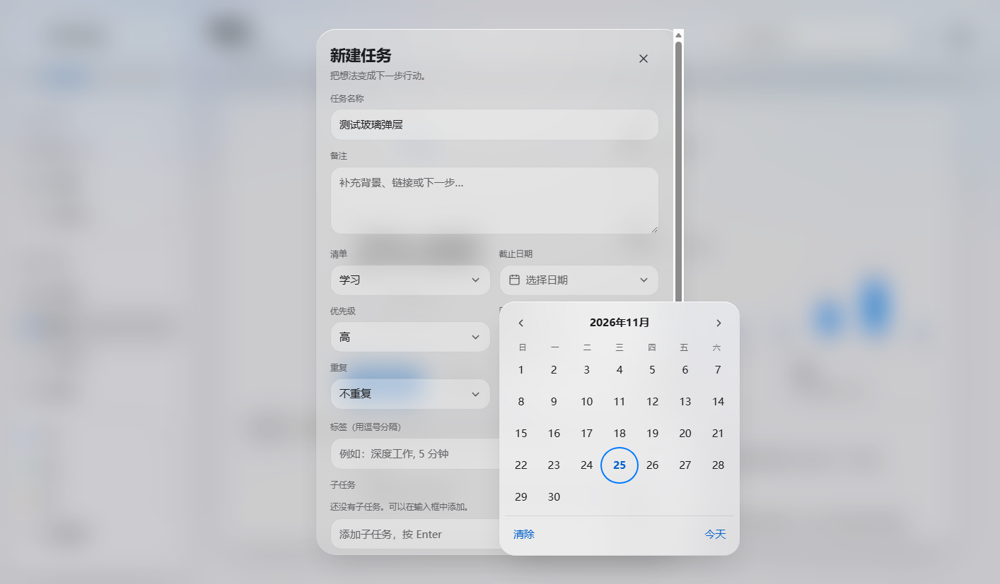

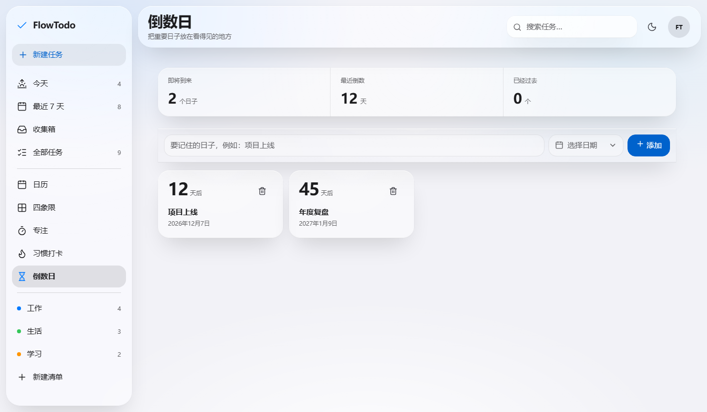

## 交付物

- [FlowTodo.html](./FlowTodo.html)：完整应用，双击即可打开，无需安装依赖。
- [manifest.webmanifest](./manifest.webmanifest)：PWA 名称、图标、启动地址与快捷入口。
- [sw.js](./sw.js)：Service Worker，缓存应用外壳，支持 HTTP(S) 下离线打开。
- `素材/icon.svg`、`icon-180.png`、`icon-192.png`、`icon-512.png`：自绘蓝底白勾图标。
- `素材/预览.png`、`素材/预览-手机.png`：1440 × 920 与 390 × 844 浅色验收截图。
- `素材/预览-深色.png`、`素材/预览-手机-深色.png`：同尺寸深色模式验收截图。
- `素材/预览-今天-课程.png`、`素材/预览-今天-课程-手机.png`：今天页“已结束 + 即将开始”课程摘要（示例数据）。
- `素材/预览-日历.png`、`素材/预览-日历-手机.png`：日历板块桌面/手机浅色预览。
- `素材/预览-日历-深色.png`、`素材/预览-日历-手机-深色.png`：日历板块桌面/手机深色预览。
- `素材/预览-课表.png`、`素材/预览-课表-手机.png`：周课表桌面/手机预览（示例数据，含导入与全部课程入口）。
- `素材/预览-删除清单.png`：删除清单时“保留任务 / 一并删除”的确认预览。
- `素材/预览-玻璃下拉.png`：自绘液态玻璃下拉菜单预览。
- `素材/预览-玻璃日期.png`、`素材/预览-玻璃日期-移动端.png`：单月玻璃日期面板的桌面与 390px 预览。
- `素材/预览-倒数日.png`：倒数日独立玻璃卡片的桌面预览。
- `素材/预览-手机-弹窗.png`、`素材/预览-手机-更多.png`：bottom sheet 与更多页截图。

## 已实现

- 今天、最近 7 天、收集箱、全部任务、自定义清单
- 任务新增、编辑、删除、完成、标星、优先级、标签、备注、截止日期、时间、全局搜索（任意视图）
- 自定义清单新增与删除；电脑端右键清单、移动端长按清单才触发删除，不显示常驻删除按钮；确认时默认保留任务并移到“收集箱”，也可勾选一并删除任务
- 子任务：进度显示，新增、勾选、删除
- 重复任务：每天、工作日、每周、每月、每年；完成后自动生成下一次
- 多提醒：一条任务可添加多个提醒时间；浏览器通知，拒绝权限时页面内提示
- 月历视图：仅显示当月日期，前后只保留空白占位，不渲染相邻月份日期；进入时跟随已选日期所在月，切月保留日号；单日最多 2 条任务条 + 溢出数字；右侧议程支持完成、编辑与按日新建；手机/平板自动切换为彩色圆点
- 四象限视图，支持拖拽任务到不同象限
- 专注计时：15/25/45/60 分钟；今日与最近 7 天统计、柱状图、单日最长、平均时长
- 习惯打卡：新增/删除习惯，最近 7 天打卡格，连续天数与最佳连续
- 倒数日：新增/删除，显示“还有/已过”天数，自动按临近排序；每张卡片为独立玻璃卡片，桌面横向/手机纵向间距均为 12px
- 课表：周一至周五周网格、每天 10 节、18 周；当前周与今天列高亮，前后切周、回到本周；课程详情、全部课程弹窗
- 课程编辑：课程名、颜色、备注；一门课多个时间段；复制上一时间段；教师/教室按时间段保存；单周/双周/自定义周；冲突提示后可再次保存
- 课表导入导出：CSV 导入（导入时设置学期开始日与总周数，自动识别节数）、ICS 导出；JSON 备份包含课表与课程设置
- 今天页课程摘要：显示上一节已结束和正在/即将开始的课；今天第一节不显示“上一节”；当天只有一节课且已下课时保留 10 分钟；右侧“+”进入课程详情
- 课表删除：电脑端右键课程、移动端长按课程；可选“仅取消这一周”或“删除所有周”，两种都保留课程与关联作业
- 今天页顶部日历图标打开完整课表弹窗（桌面居中、手机 bottom sheet），弹窗内可前后切周
- 深色模式、响应式布局、本地自动保存
- 侧栏移除“快捷 / 视图 / 清单”分组标题，顶栏移除“快捷 / 视图 / 导航”分类小标题；左上角只保留勾选标记与 `FlowTodo` 字标
- 侧栏三组导航之间加入 `0.5px` 发丝分隔线；清单删除入口隐藏在右键 / 长按交互中，键盘聚焦清单后按 `Delete` 也可触发
- 桌面端只保留右上角一套主题切换与 `FT` 数据入口，不再重复显示侧栏底部控件
- 重绘无闪烁：入场动画只在首次加载执行，任务完成、选日期、切主题等后续交互不再整页淡入
- 弹窗操作栏回到内容末尾：取消、保存、创建、删除按钮不再吸附在弹窗底部，也不遮挡字段
- 数据备份：JSON 导出/导入恢复（包含课表与课程设置），Markdown 导出
- 空白初始状态：首次加载为空任务、空习惯、空倒数日、空专注记录、空课程，保留三个默认清单和课表设置
- 数据清理：2026-11-25 首次打开带旧数据的页面时一次性清空任务、习惯、倒数日、专注记录和课表课程，保留清单与课表设置；清理不保留旧数据备份，标记键为 `flowtodo-v1-clean-data-20261125`
- iOS 26 Liquid Glass 视觉：侧栏、顶栏、搜索框、弹窗、浮动 Tab Bar 和分组内容统一使用液态玻璃材质
- inset grouped list：整组一块玻璃，行内只用 `0.5px` 发丝线，不再为每条任务堆叠白卡片
- 原生表单弹层替换：清单、优先级、四象限、重复和专注任务下拉改为自绘玻璃菜单；截止日期与倒数日期改为单月玻璃日历；原生 `select` / `date` 仍保留为取值与表单提交来源
- 选中图标细节修复：侧栏与 Tab Bar 选中态不再把 Lucide 路径整体填实，改为同色描边 + `14%` 同色填充；日历、专注、习惯、今天等图标内部线条保持可见
- 悬浮结构：顶栏与 Tab Bar 不占布局高度，内容从其下方穿过；滚动后背景透明度升至 `.72`，高度收缩 `4px`
- 指针跟随高光：用 `--mx` / `--my` 记录指针位置，在玻璃 `::before` 上叠加径向高光
- 按下反馈：玻璃控件 `scale(.97)` + 高光增强，时长 `200ms`，缓动 `cubic-bezier(.32,.72,0,1)`
- 深色玻璃：`rgba(28,28,30,.52)`，顶部高光 `.16`，外圈发丝线 `.10`
- 桌面悬浮侧栏 + 手机浮动胶囊 Tab Bar；手机端无侧栏，弹窗改为 bottom sheet
- 删除任务提供 6 秒 Undo，支持按钮撤销与 `Ctrl+Z` / `Cmd+Z`
- PWA：manifest、Service Worker、应用外壳离线缓存、安装快捷入口
- 键盘 `focus-visible` 外环、44px 点击区域；`prefers-reduced-motion` 下降级为纯淡入

## 设计与交互

- 颜色：浅色背景 `#F2F2F7`、内容面 `#FFFFFF`、主文字 `#1C1C1E`；深色背景 `#000000`、内容面 `#1C1C1E`、抬升面 `#2C2C2E`。
- 强调色：浅色系统蓝 `#007AFF`、深色 `#0A84FF`；小字号文字和填充按钮使用同色系的 WCAG AA 变体 `#0062CC` / `#0A6ED1`。没有紫色或第二套蓝紫色系统。
- 材质：玻璃背景浅色 `rgba(255,255,255,.48)`、深色 `rgba(28,28,30,.52)`；`backdrop-filter: blur(30px) saturate(180%)`；阴影固定为顶部 `inset 0 1px 0` 镜面、底部 `inset 0 -1px 0` 落座、外圈 `0 0 0 .5px` 发丝线和 `0 24px 48px -16px` 大范围外投影。
- 字体：系统字体栈，正文 15px，页面大标题 30px（手机 28px），辅助文字 12–13px，数字启用 `tabular-nums`。
- 布局：4/8 间距系统；侧栏 252px；内容最大宽度 1100px，1440px 视口实测 1062px；任务行实测 62.5–63.5px，落在 52–64px 目标内。
- 圆角：容器 `28px` → 分组 `22px` → 行内控件 `16px`；任务行本身无圆角、无边框、无阴影，只保留 `0.5px` 发丝分隔线。
- 悬浮：顶栏与 Tab Bar 使用 `position: fixed`，不占布局高度；滚动超过 24px 后背景升至 `.72`，顶栏与 Tab Bar 各收缩 4px。
- 手机 Tab Bar：左右各内缩 12px、底部内缩 12px、高 56px、圆角 28px、图标 25px、文字 10px。
- 图标：界面图标使用 Lucide 官方 24 网格路径；常规仅 17 / 20 / 24px 三档，描边分别为 2 / 1.75 / 1.6，任务元信息为 14px / 1.9，手机 Tab Bar 图标按玻璃布局为 25px / 1.6；颜色继承 `currentColor`，选中态为同色描边 + `14%` 同色填充、未选中为描边；没有彩色图标底块、发光或投影。
- 动效：180–260ms（主交互 200ms），`cubic-bezier(.32,.72,0,1)`；按下 `scale(.97)` 并增强高光；无弹跳、旋转或大于 `1.02` 的放大。视图入场只用于首屏，后续点击直接更新，避免整页闪烁。
- 弹窗：任务、清单和删除确认共用底部文件流布局，操作栏在最后一个字段之后出现；移动端不再使用 sticky footer。
- 表单弹层：`select` 与 `date` 的原生 Windows 弹层不再出现；触发器与浮层沿用同一套玻璃材质、`22px` 圆角和 `44px` 点击区，菜单选中项用系统蓝与勾选标记，日期只渲染当前月份并用系统蓝实心圆标记选中日。
- 倒数日卡片：网格容器透明、无阴影；每张卡片单独使用 `var(--glass-bg)`、`22px` 圆角和完整玻璃阴影，与相邻卡片保留 `12px` 间距。
- 课表：整块玻璃面板 + `0.5px` 细网格；课程卡使用系统色 `17%` 淡色底 + `3px` 左侧色条，深色为 `24%`；今天列浅蓝底；手机压缩时间列与卡内字号，仍保持 44px 点击区；今天页课程条用同色淡底区分“已结束 / 即将开始”。
- 无障碍：玻璃上的文字对比度达到 WCAG AA；`prefers-reduced-motion` 下取消位移与缩放，只保留 160ms 纯淡入。
- 负面清单：无毛玻璃卡片堆叠、无紫蓝渐变、无彩色玻璃 tint、无 6px 以下硬阴影、无亮边框加亮阴影、无发光文字。

## CSS 分层合并

2026-11-25 对 `FlowTodo.html` 的样式层做了一次保守合并：只删除同选择器、同上下文里已被后续同名声明覆盖的旧声明，以及真正逐字重复的整条规则；不跨选择器搬运声明，不改变层叠顺序，不合并不同 `@media` / 深色 / 悬停 / 聚焦上下文。

| 指标 | 合并前 | 合并后 | 变化 |
| --- | ---: | ---: | ---: |
| CSS 字符数 | 94,698 | 72,513 | -22,185（-23.4%） |
| CSS 行数 | 2,125 | 1,829 | -296（-13.9%） |
| 规则数 | 828 | 689 | -139（-16.8%） |
| CSSOM 重复选择器 | 238 | 163 | -75（-31.5%） |
| CSSOM 逐字重复规则组 | 38 | 6 | -32（-84.2%） |
| 同上下文逐字重复规则组 | 30 | 0 | 清零 |
| 删除的被覆盖声明 | — | 777 | — |

剩余 6 组“逐字重复”是同一段规则文本分别出现在桌面、移动、深色或媒体查询等不同上下文；按 CSSOM 全文比较会被计为重复，但删除任意一份都会改变对应断点或主题，因此保留。剩余 163 个同名选择器也主要是响应式、深色和交互状态规则，不是可安全删除的重复。

## 功能覆盖对照

当前版本覆盖个人任务管理 + 课表 + 习惯/倒数日/专注统计，仍不是完整 TickTick 产品。

| 能力 | 当前状态 |
| --- | --- |
| 界面风格 / PWA | 已实现 iOS 26 Liquid Glass、悬浮顶栏与 Tab Bar、bottom sheet、manifest 与离线外壳 |
| 任务、清单、标签、优先级、截止日期、搜索 | 已实现，单机版；清单可新增、删除，删除时可选保留任务 |
| 子任务 | 已实现：进度、编辑、勾选 |
| 重复任务 | 已实现：每天/工作日/每周/每月/每年，完成时生成下一次 |
| 多提醒 | 已实现：每任务多个提醒；浏览器通知需页面打开 |
| 附件、任务模板 | 未实现 |
| 今天、最近 7 天、收集箱、全部任务 | 已实现 |
| 课表 | 已实现：周网格、多时间段、单双周/自定义周、CSV 导入、ICS 导出、今天摘要、课程详情与关联作业；不做教务系统直连和后台提醒 |
| 月历与按日任务面板 | 已实现仅本月日期的月网格、任务条/圆点、当日议程与按日新建；不能拖拽排期或同步外部日历 |
| 四象限 | 已实现拖拽，但没有自定义分类规则 |
| 专注计时 | 15/25/45/60 分钟，今日/7 天统计；没有白噪音、后台计时、系统级提醒 |
| 习惯打卡、倒数日 | 已实现 |
| 导入导出、备份恢复 | 已实现 JSON 备份/恢复与 Markdown 导出 |
| 账号登录、云同步、多设备、冲突合并 | 未实现 |
| 共享清单、成员分配、评论协作 | 未实现 |
| 系统通知、小组件、Siri、Watch、原生 App | 仅浏览器通知（页面打开时）；其余未实现 |
| 回收站、归档、跨设备全局搜索 | 未实现 |
| OCR、语音录入、AI 助手 | 未实现 |

因此，单机个人使用的主要闭环已经可运行；云同步、协作、原生端和系统集成仍是缺口。

## 使用

双击 `FlowTodo.html`，或直接拖进浏览器。

可直接打开指定视图：

- 日历：`FlowTodo.html?view=calendar`
- 课表：`FlowTodo.html?view=timetable`
- 四象限：`FlowTodo.html?view=matrix`
- 专注：`FlowTodo.html?view=focus`
- 习惯打卡：`FlowTodo.html?view=habits`
- 倒数日：`FlowTodo.html?view=countdown`
- 更多：`FlowTodo.html?view=more`
- 深色：`FlowTodo.html?theme=dark`

快捷键：

- `N`：新建任务
- `/`：聚焦搜索
- `Esc`：先关闭正在展开的下拉 / 日期弹层，再关闭弹窗或底部 sheet
- `Ctrl+Z` / `Cmd+Z`：撤销最近一次任务删除

电脑端右键清单、移动端长按清单即可删除。确认弹窗默认保留任务并移到“收集箱”，勾选“同时删除清单中的任务”后才会连带删除；键盘聚焦清单时按 `Delete` 也可触发。

课表页右上角“导入课表”选择 CSV；导入时可设置学期开始日与总周数，导入会替换全部课表，不影响任务、清单、习惯、倒数日和专注记录。电脑右键 / 手机长按课程可删除：仅取消这一周，或移除该时间段；课程和关联作业都会保留。今天页顶部的日历图标可在桌面和手机打开完整课表弹窗。

桌面端点击右上角头像、手机端进入“更多 > 数据与备份”，可导出 JSON 备份、导出 Markdown、导入备份，或清空任务与记录（清单保留）。
所有任务、课表、习惯、倒数日和专注记录保存在当前浏览器的 `localStorage` 中。

## PWA 安装

Service Worker 只在 HTTP(S) 下注册。直接双击 `FlowTodo.html` 仍可正常使用，但没有离线缓存和安装入口。

在本项目目录启动一个静态服务器：

```powershell
python -m http.server 8000
```

然后打开 `http://localhost:8000/FlowTodo.html`，在 Edge / Chrome 地址栏点击安装图标，或使用菜单中的“安装此站点 / 应用”。

## 数据与提醒边界

- JSON 备份包含任务、清单、子任务、重复规则、提醒、课表、课程设置、习惯、倒数日和专注记录。
- 导入备份会替换当前全部数据；导入前会二次确认，并自动在本地保存一份「导入前备份」，可从「数据与备份」弹窗一键恢复。
- 2026-11-25 起首次加载带旧数据时执行一次性清理：任务、习惯、倒数日、专注记录和课表课程清零，清单与课表设置保留；清理不写入旧数据备份，标记键为 `flowtodo-v1-clean-data-20261125`，之后刷新不会再次清理。
- 旧备份已清除：首次打开新版本时会一次性删除 `flowtodo-v1-before-clean-data-20261125`、`flowtodo-v1-before-clean-test-20261125` 和旧的 `flowtodo-v1-backup`；之后主动“导入 JSON”仍会正常生成新的导入前备份。
- 删除清单默认保留任务并移到“收集箱”；勾选“同时删除清单中的任务”后，任务删除不可恢复。
- 课表 CSV 只导入有固定星期和节次的课程；实践课等没有固定排课的记录会跳过。课表本身不发送提醒，课程详情里的“布置了作业”复用任务提醒。
- 提醒依赖页面保持打开；关闭页面后，普通网页无法在后台执行提醒。页面重新打开时只补发最近 24 小时内的提醒，最多 3 条，其余直接标记为已触发。
- 浏览器拒绝通知权限时，提醒改为页面内短提示。
- PWA 离线缓存只缓存应用外壳；任务和课表数据仍在 `localStorage`，不会随 Service Worker 同步到其他设备。
- 清除浏览器站点数据会删除本地任务，操作前请导出 JSON 备份。

## 验收记录

- 桌面：Edge 无头模式，`1440 × 920`，侧栏 252px，内容区 1062px，任务行 62.5–63.5px，无横向溢出。
- 玻璃实测：顶栏、侧栏、任务组背景均为 `rgba(255,255,255,0.48)`；`backdrop-filter: blur(30px) saturate(1.8)`；阴影包含 `inset 0 1px 0 rgba(255,255,255,.85)`、`inset 0 -1px 0 rgba(0,0,0,.06)`、`0 0 0 .5px rgba(0,0,0,.05)` 和 `0 24px 48px -16px rgba(0,0,0,.16)`；侧栏右边框为 0。
- 圆角实测：侧栏/顶栏/弹窗 28px，任务组 22px，输入框与行内控件 16px；任务行圆角 0、无阴影，行间为 `0.5px` 发丝线（DPR 1 下按 1 设备像素渲染）。
- 滚动实测：桌面顶栏背景升至 `rgba(255,255,255,0.72)`、高度 84 → 80px；手机顶栏 80 → 76px（≤480px 时 72 → 68px），Tab Bar `rgba(255,255,255,0.72)`、56 → 52px。
- 间距实测：任务元信息行 `6px 12px`，任务行 62.5–63.5px；顶栏 84px（手机 80/72px），390px 下标题完整、无横向溢出。
- 日历实测：1440px 下 722px 月网格 + 340px 议程；2026 年 11 月只渲染 30 个本月日期 + 5 个空白占位，5 行、格高 100px；2027 年 1 月渲染 31 个本月日期，6 行。390px 下为彩色圆点、格高 62px；800px 平板为 68px 圆点模式；均无相邻月份日期、无横向溢出。切月实测 `11月25日 → 12月25日 → 11月25日`。
- 侧栏与顶栏实测：`.nav-label` 数量 0，顶栏分类小标题不存在，侧栏底部重复控件不存在；桌面端主题按钮与 `FT` 头像各仅 1 个；品牌区文本只有 `FlowTodo`。
- 侧栏分隔实测：2 条 `.nav-sep`，高度均为 `0.5px`，浅色为 `rgba(0,0,0,.14)`；清单行常驻删除按钮数量为 0，无横向溢出。
- 清单删除入口实测：电脑端右键“学习”成功打开删除确认；390px 触屏模拟长按 550ms 后弹窗打开，松手产生的点击被抑制，页面仍停留在“更多”，没有误进入清单。
- 弹窗实测：任务、清单、删除确认三类弹窗的操作栏均处于文档流，`position` 为 `relative/static`，不是 `sticky`；任务弹窗操作栏位于提醒字段之后，并在首屏视口下方。
- 表单弹层实测：原生 `select` / `date` 计算样式为 `opacity: 0`、`pointer-events: none`，不再弹出 Windows 原生菜单；专注任务下拉渲染 10 个选项并可写回 `focus.taskId`；2026 年 11 月日期面板仅渲染 30 个本月日期，无 10 月或 12 月日期；下拉项与日期格均为 44px；浅色浮层 `rgba(255,255,255,0.48)`、深色 `rgba(28,28,30,0.52)`，均为 `22px` 圆角；键盘 `↑` / `↓` + `Enter`、月份前后切换、外部点击关闭与 `Esc` 关闭均通过，且 `Esc` 只关闭浮层，不关闭当前页面或任务弹窗。
- 倒数日卡片实测：1440px 下 2 张卡片各 250px、水平间距 12px；390px 下各 358px、垂直间距 12px；容器背景透明且无阴影/模糊，卡片为 `rgba(255,255,255,0.48)`、`22px` 圆角、`blur(30px) saturate(180%)`，无横向溢出。
- 清单删除实测：删除“学习”且不勾选时，2 个任务移入“收集箱”，当前清单视图自动回退到“收集箱”；删除“生活”并勾选时，任务总数由 10 降至 6，清单与任务同时移除。
- 重绘实测：首次加载内容容器带 `view-enter`；点击任务后容器不再带该类，`animation-name` 为 `none`，无整页淡入闪烁；控制台无 JavaScript 异常。
- 手机：`390 × 844`，侧栏隐藏，浮动 Tab Bar 左右 12px、底部 12px、高 56px、圆角 28px、图标 25px、文字 10px；搜索框保持玻璃材质，点击后聚焦并展开至约 203px，无横向溢出。
- 弹窗：手机端实测为底部 sheet，顶部圆角 28px、底部 0，宽度 390px，带拖拽把手与安全区内边距。
- 深色实测：玻璃 `rgba(28,28,30,0.52)`，顶部高光 `rgba(255,255,255,0.16)`，外圈线 `rgba(255,255,255,0.10)`，大范围外投影 `rgba(0,0,0,0.32)`。
- 指针高光：指针移到顶栏后 `--mx: 160px`、`--my: 32px`，`::before` 生成 `radial-gradient(circle at 160px 32px, rgba(255,255,255,0.35), transparent 60%)`。
- reduced-motion：顶栏过渡为 `none`，视图动画改为 `reducedFade 160ms`，滚动后顶栏不收缩（仍为 84px，手机 80/72px），按钮按下 `transform: none`。
- 对比度实测：浅色正文 16.08、辅助文字 5.66、强调文字 5.20、主按钮文字 5.80；深色正文 19.22、辅助文字 5.82、强调文字 5.27、主按钮文字 5.04；均达到 WCAG AA。
- 交互：新建带子任务/重复/提醒的任务、提醒触发、重复任务生成、删除 Undo、习惯打卡、倒数日、专注计时、JSON/Markdown 导出、JSON 导入均通过。
- 交互状态：任务次要操作悬停时透明度 `0 → 1`；键盘 Tab 焦点显示 2px 系统蓝外环；所有可见按钮与输入框具备 hover / active / focus-visible 状态，点击区均 ≥44px；正文最小字号 11px，手机 Tab Bar 标签按规范为 10px。
- 图标验收：桌面可见尺寸仅 14（任务元信息）/ 17 / 20 / 24px，描边 1.9 / 2 / 1.75 / 1.6；手机 Tab 图标 25px / 1.6；选中导航与 Tab 为同色描边 + `fill-opacity: .14`、未选中描边；日历、专注、习惯、今天等图标内部线条不再被实心填充吞掉；无彩色图标底块与 `sparkles`；空状态为 20px 灰色字形 + 单行灰字；按压为 200ms 的 opacity + `scale(.97)`。
- PWA：`Page.getAppManifest` 返回 0 错误，无可安装性问题；Service Worker 缓存版本为 `v6`，状态 `activated`，已接管页面并缓存 5 个预缓存外壳文件。
- 空白初始与清理实测：全新上下文为 `0` 任务、`0` 习惯、`0` 倒数日、`0` 专注记录、`0` 课程，保留三个默认清单和 `2026-09-07` / 18 周 / 10 节设置；预置旧数据加载后五项清零、清单与课表设置保留、不生成清理前备份，刷新不重复清理；“清空任务与记录”把任务与课程降为 `0`。
- 旧备份清除实测：预置 `flowtodo-v1-before-clean-data-20261125`、`flowtodo-v1-before-clean-test-20261125` 和 `flowtodo-v1-backup` 后首次打开，三个旧键均被删除，且不再生成新的清理前备份；旧任务与旧课程按清理规则清零，清单与课表设置保留；已清理过的数据只删备份、不清数据。
- 课表实测：1440 × 920 第 12 周渲染 3 个课程卡（周一至周五 5 列、10 节），前后切周 `12 → 11 → 12`，今天列 `11/25` 高亮；本周无课时显示“这一周没有课程”空状态，导入按钮仍可用；390 × 844 无横向溢出。
- 今天课程卡片实测：09:50 显示“高等数学 已结束 08:00–09:40”和“大学物理 即将开始 10:00–11:40”两张卡；第一节上课时只显示当前课；当天最后一节下课后保留 10 分钟，超时后回到“今天没有课，去享受自由时间吧”。
- 课表编辑与删除实测：新建课程默认时段保存触发冲突提示“与「高等数学」周三第 1–2 节冲突”，再次保存成功；右键课程可选择“仅删除第 12 周”（`cancelledWeeks=[12]`，课程保留）或“删除所有周”（移除时间段、课程保留）；CSV 导入识别 2 门固定课程、跳过 1 门无固定排课，导入后学期设置与任务数据不受影响；ICS 导出含 `BEGIN:VEVENT`；JSON 备份包含 `timetable`。
- 今天课程弹窗实测：桌面点击今天页顶部日历图标打开完整课表弹窗，手机同样打开 bottom sheet；`Esc` 关闭，弹窗内前后切周正常，无横向溢出。
- 数据回归实测：今天、最近 7 天、收集箱、全部任务、日历、课表、四象限、专注、习惯、倒数日、更多 11 个视图在 `1440 × 920` 与 `390 × 844` 下均无横向溢出，控制台无异常。
- 浏览器控制台：无 JavaScript 异常。
- CSS 合并验证：固定 41 个页面状态（桌面/平板/手机、浅色/深色、今天/日历/四象限/专注/习惯/倒数日/更多、任务与清单弹窗、玻璃下拉/日期、悬停/聚焦/按压、reduced-motion），对 479 个选择器、211 个计算属性与 40 个自定义属性逐元素比较 Computed 值；每个状态 19,639 项，共 805,199 项。基线对基线自检 0 差异，合并前后 0 差异，无 JavaScript 异常；1440 × 920 与 390 × 844 截图已重新生成。
- 2026-11-25 只读审计后的修复：导入 JSON 中的 `id`、清单名、习惯图标不再能注入 HTML（三处 XSS 复现点均为 `false`）；重复任务同一实例只生成一次下一次，取消完成会撤回未改动的下一次（实测 1 → 2 → 1 → 2）；`subtasks` / `countdowns` / `focusLog` 含空元素时不再整页空白，渲染异常降级为单条提示；`收集箱` 不能再作为自定义清单名；四象限任务 `tabindex` 覆盖 9/9，支持 `Enter` 编辑与 `Alt + 方向键` 移动；搜索框与快速添加框补齐 `aria-label`；超时或过旧的提醒不再刷屏。

## 来源与边界

- 视觉与功能参考来自用户提供的 `TickTick_8.0.90_Pro.ipa` 的公开界面结构与任务管理概念。
- 该 IPA 含 `CydiaSubstrate.framework`、`blatantsPatch.dylib` 等注入组件，属于第三方补丁包；
  本项目没有复用其中的代码、图片、字体、文案或补丁。
- Apple HIG 与 iOS 26 Liquid Glass 仅作为设计语言参考；液态玻璃材质由本项目用 CSS 原创实现，没有复制 Apple 图标、截图、字体文件或受保护素材。界面图标来自 Lucide 官方 24 网格路径，PWA 应用图标为原创蓝底白勾。
- 本项目是原创实现，不宣称与 TickTick 像素级一致，也不包含其账号同步、订阅、系统通知、
  小组件、Siri、云服务或 iOS 原生能力。
- 提醒、专注计时和本地保存均受浏览器能力限制；本项目没有后台服务。

## 复现方式

1. 打开 `FlowTodo.html`。
2. 首次加载为空任务、空习惯、空倒数日、空专注记录、空课表课程，保留三个默认清单和课表设置。
3. 新建任务时可添加子任务、重复规则和多个提醒；完成重复任务会自动生成下一次，同一实例只生成一次，取消完成会撤回尚未编辑的下一次。
4. 课表页右上角“导入课表”选择 CSV，确认学期开始日和总周数后替换课表；右键 / 长按课程可删除单周或全部时间段。
5. 右上角头像可导出/导入 JSON 备份，或清空任务与记录（清单和课表设置保留）。
6. 需要安装为 PWA 时，按上面的静态服务器步骤通过 `http://localhost:8000` 打开。
7. 如需彻底清空，点击头像清空任务与记录，或清除该文件来源的浏览器站点数据。

## 位置说明

项目位于 `D:\AI\Workplace\chatgpt\FlowTodo`。应用主体是 `FlowTodo.html`，可单独复制使用；
PWA 安装与离线缓存还需要同目录的 `manifest.webmanifest`、`sw.js` 和 `素材/` 图标。
课表预览使用示例课程数据，仅用于 README 截图；实际应用首次打开时课程为空。
